# Galeri gaya Code Cinema

Pratinjau satu frame dari film demo setiap gaya, dikelompokkan per kategori. Klik gambar untuk membuka `STYLE.md` gaya itu. Untuk membuat film, sebut nama gayanya ke Claude, misalnya: *"Buat film 45 detik gaya Watercolor Brush tentang …"*.

Gaya bertanda ✦ menggambar karakternya dengan generator gambar yang Anda sediakan. Daftar berbentuk tabel ada di [styles/README.md](styles/README.md).

**Kategori:** [Edit & Dokumenter](#edit--dokumenter) · [Lukisan & Ilustrasi](#lukisan--ilustrasi) · [Sketsa & Papan](#sketsa--papan) · [Kerajinan Tradisional](#kerajinan-tradisional) · [Cetak & Seni Grafis](#cetak--seni-grafis) · [Grafis & Tipografi](#grafis--tipografi) · [Diagram Garis](#diagram-garis) · [Kartun](#kartun) · [Game](#game) · [Film & Pita](#film--pita) · [Layar & Antarmuka](#layar--antarmuka) · [Cahaya & Garis](#cahaya--garis) · [3D & Miniatur](#3d--miniatur) · [Instrumen & Bukti](#instrumen--bukti) · [Data & Peta](#data--peta)

## Edit & Dokumenter

Edit & Documentary · 8 gaya

<table>
<tr>
<td width="33%" valign="top"><a href="styles/caption-news/STYLE.md">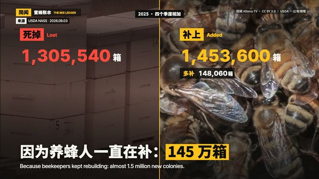</a> <b>Caption News</b> <code>caption-news</code> · Berita media sosial, Penjelasan laporan, Video data singkat</td>
<td width="33%" valign="top"><a href="styles/newsreel/STYLE.md">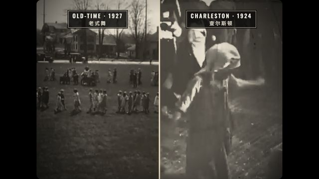</a> <b>1920s Newsreel</b> <code>newsreel</code> · Kisah sejarah, Tren & era, Ulang tahun & peringatan</td>
<td width="33%" valign="top"><a href="styles/countdown/STYLE.md">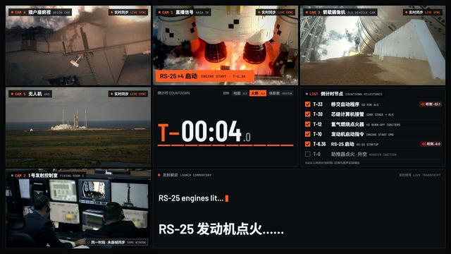</a> <b>Live Countdown Split-screen</b> <code>countdown</code> · Peluncuran, Hitung mundur, Acara langsung</td>
</tr>
<tr>
<td width="33%" valign="top"><a href="styles/city-symphony/STYLE.md">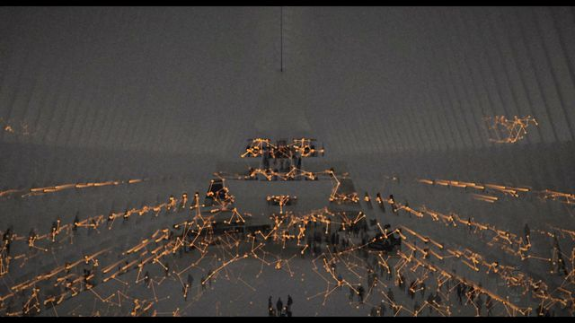</a> <b>City Symphony</b> <code>city-symphony</code> · Film kota, Montase musik, Pembuka</td>
<td width="33%" valign="top"><a href="styles/visual-investigation/STYLE.md">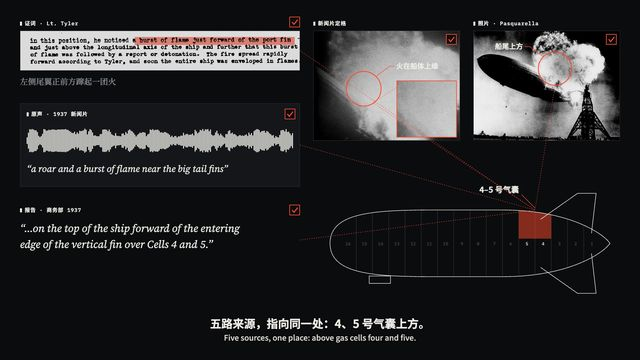</a> <b>Visual Investigation</b> <code>visual-investigation</code> · Rekonstruksi, Cek fakta, Laporan insiden</td>
<td width="33%" valign="top"><a href="styles/kino-montage/STYLE.md">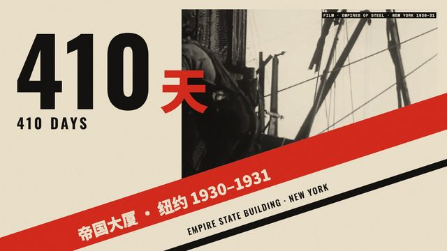</a> <b>Constructivist Montage</b> <code>kino-montage</code> · Sejarah industri, Tonggak pencapaian, Kerja bersama</td>
</tr>
<tr>
<td width="33%" valign="top"><a href="styles/telestrator/STYLE.md">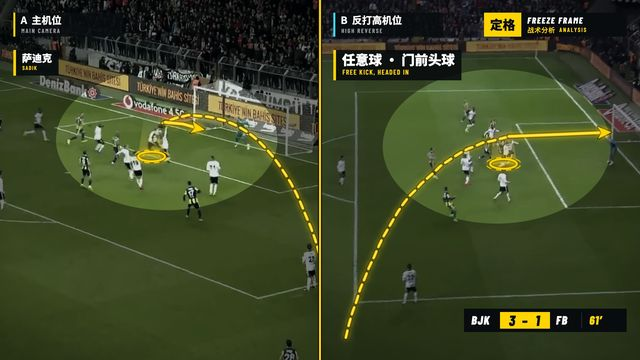</a> <b>Sports Telestrator</b> <code>telestrator</code> · Analisis olahraga, Rekap pertandingan, Coaching</td>
<td width="33%" valign="top"><a href="styles/news-package/STYLE.md">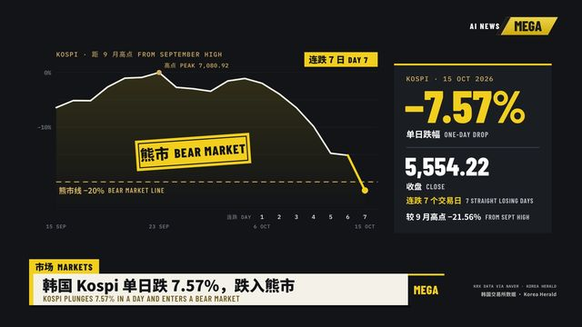</a> <b>Broadcast News Package</b> <code>news-package</code> · Rangkuman berita, Buletin, Update pasar</td>
</tr>
</table>

## Lukisan & Ilustrasi

Painting & Illustration · 5 gaya

<table>
<tr>
<td width="33%" valign="top"><a href="styles/crayon-book/STYLE.md">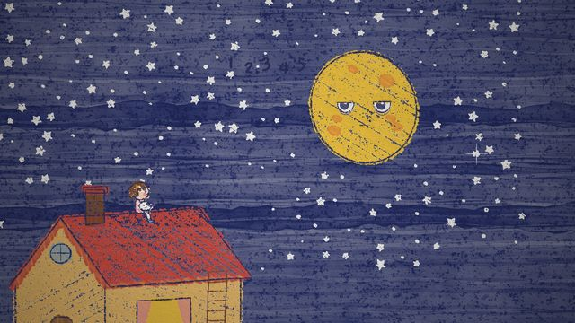</a> <b>Crayon Picture Book</b> <code>crayon-book</code> · Buku bergambar, Dongeng sebelum tidur, Belajar anak</td>
<td width="33%" valign="top"><a href="styles/watercolor/STYLE.md">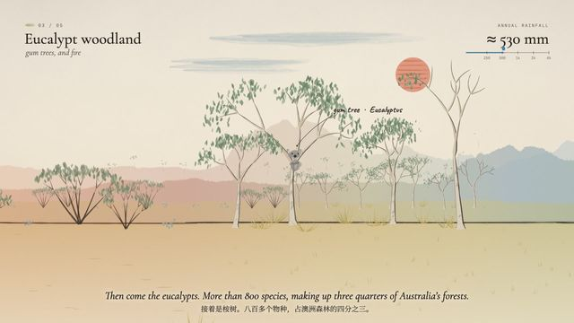</a> <b>Watercolor Brush</b> <code>watercolor</code> · Dokumenter alam, Wisata, Penjelasan sains</td>
<td width="33%" valign="top"><a href="styles/impasto/STYLE.md">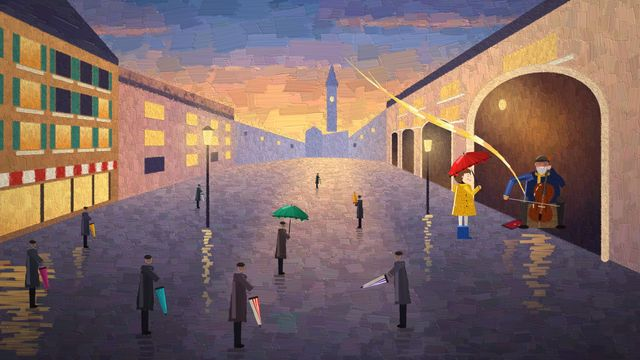</a> <b>Impasto Oil Painting</b> <code>impasto</code> · Video musik, Seni & budaya, Iklan emosional</td>
</tr>
<tr>
<td width="33%" valign="top"><a href="styles/urban-sketch/STYLE.md">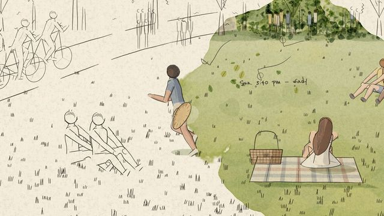</a> <b>Urban Sketch · Pen & Wash</b> <code>urban-sketch</code> · Kota & wisata, Arsitektur, Brand gaya hidup</td>
<td width="33%" valign="top"><a href="styles/colored-pencil/STYLE.md">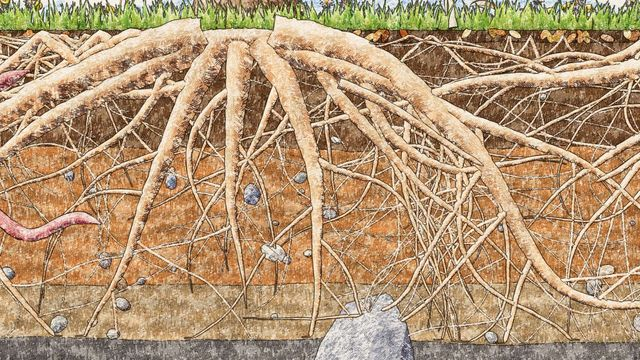</a> <b>Colored-Pencil Science Illustration</b> <code>colored-pencil</code> · Penampang ilmu alam, Explainer buku bergambar, Struktur & proses tersembunyi</td>
</tr>
</table>

## Sketsa & Papan

Sketch & Board · 7 gaya

<table>
<tr>
<td width="33%" valign="top"><a href="styles/one-line/STYLE.md">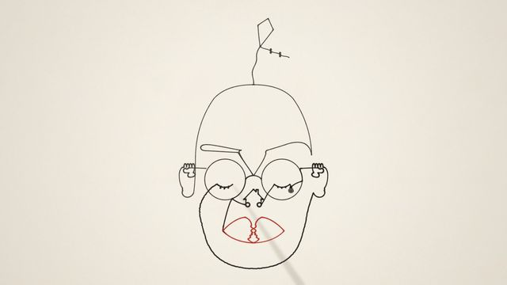</a> <b>One-line Drawing</b> <code>one-line</code> · Kisah brand, Momen penting hidup, Iklan minimalis</td>
<td width="33%" valign="top"><a href="styles/whiteboard/STYLE.md">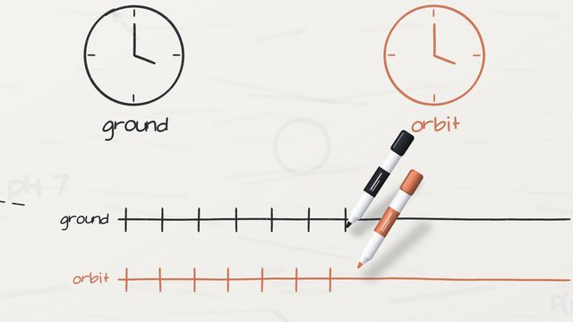</a> <b>Whiteboard Explainer</b> <code>whiteboard</code> · Explainer, Kursus online, Sains</td>
<td width="33%" valign="top"><a href="styles/chalkboard/STYLE.md">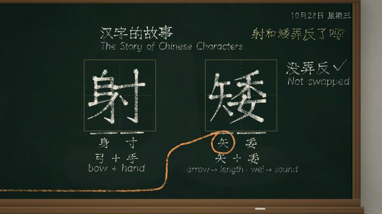</a> <b>Chalkboard</b> <code>chalkboard</code> · Asal-usul kata, Membongkar mitos, Pelajaran</td>
</tr>
<tr>
<td width="33%" valign="top"><a href="styles/sketchnote/STYLE.md">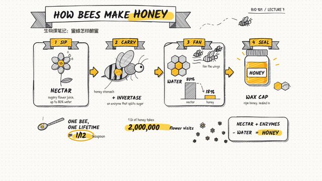</a> <b>Sketchnote</b> <code>sketchnote</code> · Catatan kuliah, Penjelasan sains, Ringkasan satu halaman</td>
<td width="33%" valign="top"><a href="styles/stick-explainer/STYLE.md">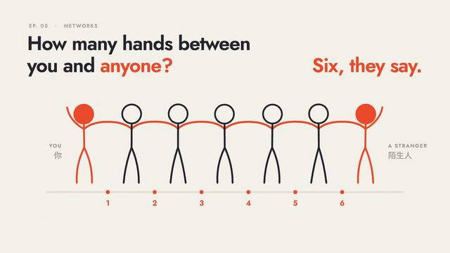</a> <b>Stick-figure Explainer</b> <code>stick-explainer</code> · Penjelasan sains, Jaringan & ide sosial, Perbandingan data</td>
<td width="33%" valign="top"><a href="styles/ipad-sketch/STYLE.md">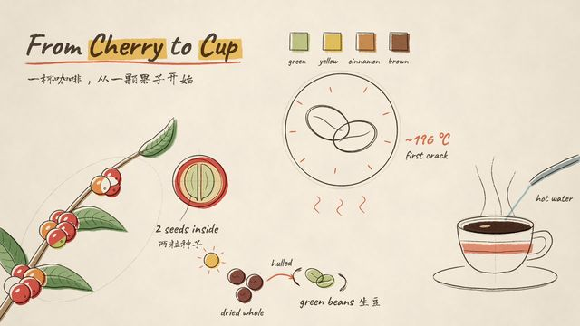</a> <b>Tablet Sketch Explainer</b> <code>ipad-sketch</code> · Penjelasan kuliner, Kerajinan & tutorial, Sains gaya hidup</td>
</tr>
<tr>
<td width="33%" valign="top"><a href="styles/marker-paper/STYLE.md">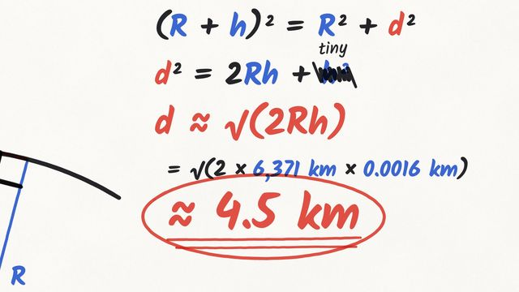</a> <b>Marker on Paper</b> <code>marker-paper</code> · Contoh soal, Penjelasan sains, Pelajaran</td>
</tr>
</table>

## Kerajinan Tradisional

Traditional Crafts · 7 gaya

<table>
<tr>
<td width="33%" valign="top"><a href="styles/ink-wash/STYLE.md">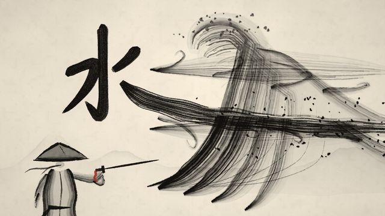</a> <b>Chinese Ink Wash</b> <code>ink-wash</code> · Wuxia, Brand budaya, Puisi</td>
<td width="33%" valign="top"><a href="styles/shadow-puppet/STYLE.md">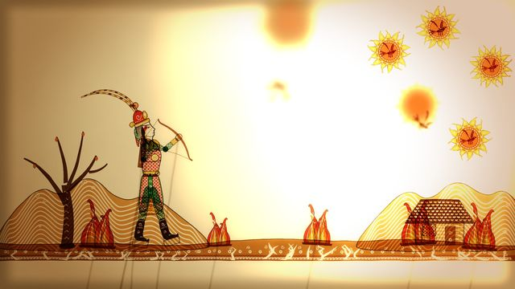</a> <b>Shadow Puppetry</b> <code>shadow-puppet</code> · Mitos & cerita rakyat, Warisan budaya, Festival</td>
<td width="33%" valign="top"><a href="styles/ukiyoe/STYLE.md">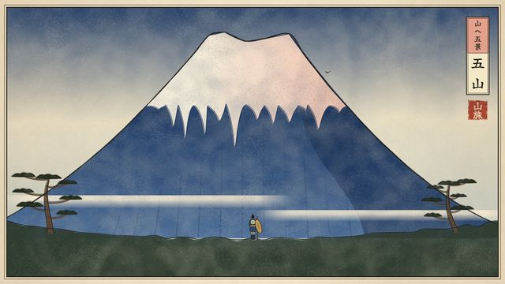</a> <b>Ukiyo-e</b> <code>ukiyoe</code> · Wisata, Budaya Jepang, Puisi</td>
</tr>
<tr>
<td width="33%" valign="top"><a href="styles/papercut-red/STYLE.md">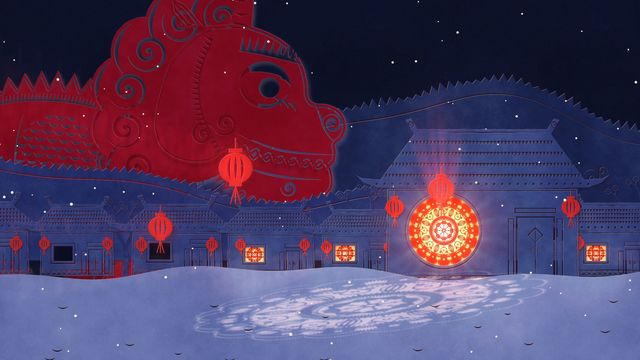</a> <b>Red Paper-cut</b> <code>papercut-red</code> · Imlek, Ucapan hari raya, Cerita rakyat</td>
<td width="33%" valign="top"><a href="styles/paper-lantern/STYLE.md">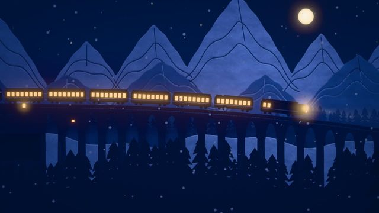</a> <b>Paper-cut Lightbox</b> <code>paper-lantern</code> · Perjalanan & wisata, Perpisahan & peringatan, Tempat & kisahnya</td>
<td width="33%" valign="top"><a href="styles/stained-glass/STYLE.md">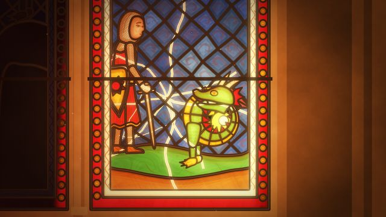</a> <b>Stained Glass</b> <code>stained-glass</code> · Legenda, Warisan budaya, Cerita liburan</td>
</tr>
<tr>
<td width="33%" valign="top"><a href="styles/gilded-illumination/STYLE.md">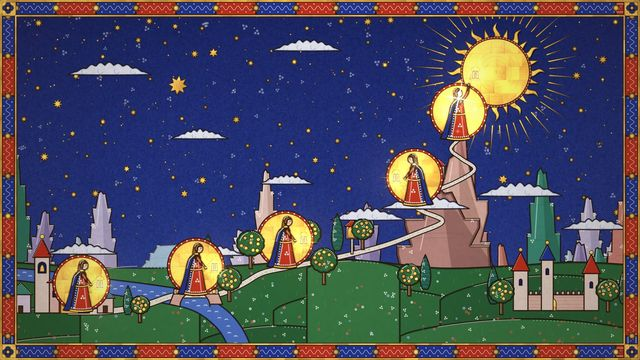</a> <b>Gilded Illumination</b> <code>gilded-illumination</code> · Fabel & cerita bergambar, Video pendek hari raya, Kisah brand & asal-usul</td>
</tr>
</table>

## Cetak & Seni Grafis

Print & Printmaking · 8 gaya

<table>
<tr>
<td width="33%" valign="top"><a href="styles/risograph/STYLE.md">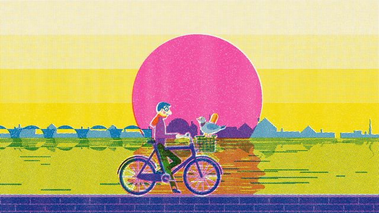</a> <b>Risograph Print</b> <code>risograph</code> · Brand indie, Zine, Gaya hidup</td>
<td width="33%" valign="top"><a href="styles/halftone-dossier/STYLE.md">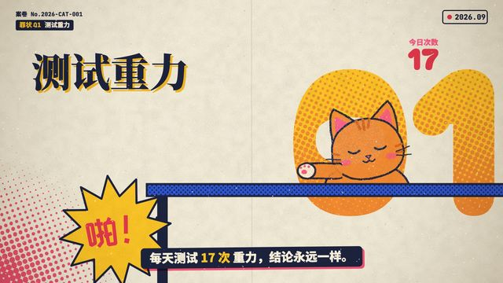</a> <b>Halftone Dossier</b> <code>halftone-dossier</code> · Humor, Konten hewan peliharaan, Video pendek media sosial</td>
<td width="33%" valign="top"><a href="styles/woodcut/STYLE.md">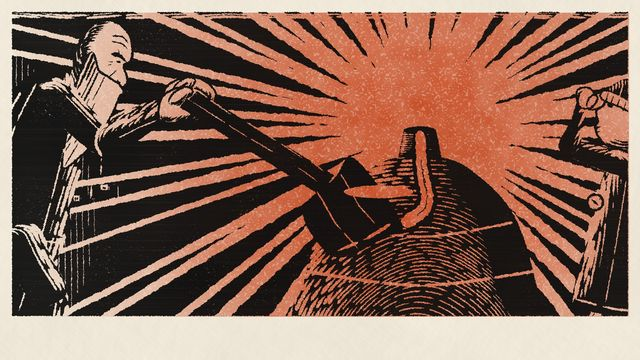</a> <b>Woodcut Print</b> <code>woodcut</code> · Cerita rakyat, Brand kerajinan, Trailer buku</td>
</tr>
<tr>
<td width="33%" valign="top"><a href="styles/engraving/STYLE.md">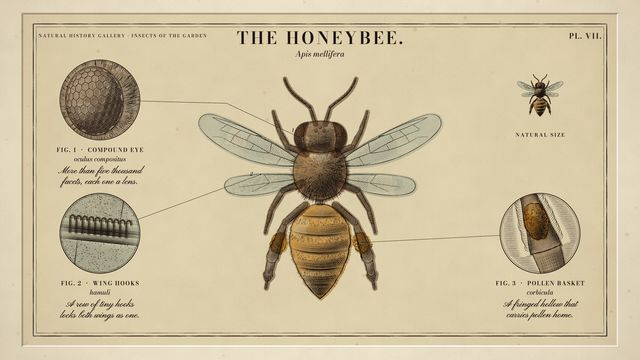</a> <b>Copperplate Engraving</b> <code>engraving</code> · Label museum, Penjelasan sains, Warisan brand</td>
<td width="33%" valign="top"><a href="styles/silkscreen-poster/STYLE.md">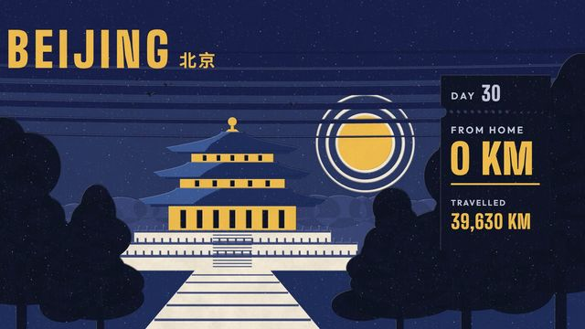</a> <b>Silkscreen Travel Poster</b> <code>silkscreen-poster</code> · Panduan destinasi, Pariwisata, Poster acara</td>
<td width="33%" valign="top"><a href="styles/printed-long-take/STYLE.md">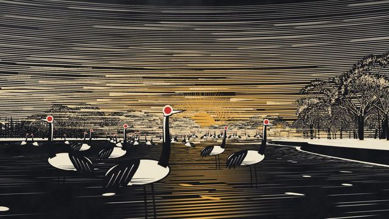</a> <b>Scratchboard Long Take</b> <code>printed-long-take</code> · Perjalanan, Satwa liar, Lanskap</td>
</tr>
<tr>
<td width="33%" valign="top"><a href="styles/pop-art/STYLE.md">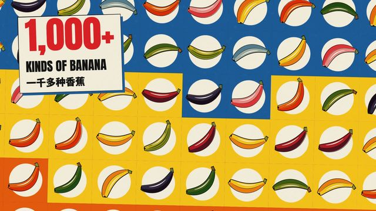</a> <b>Pop Art</b> <code>pop-art</code> · Penjelasan benda sehari-hari, Poster brand & produk, Cerita data kecil</td>
<td width="33%" valign="top"><a href="styles/vintage-collage/STYLE.md">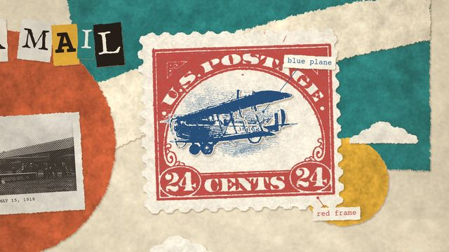</a> <b>Vintage Engraving Collage</b> <code>vintage-collage</code> · Sejarah sebuah benda, Explainer gaya majalah tentang ide & masyarakat, Kisah arsip & koleksi</td>
</tr>
</table>

## Grafis & Tipografi

Graphic & Type · 8 gaya

<table>
<tr>
<td width="33%" valign="top"><a href="styles/swiss-motion/STYLE.md">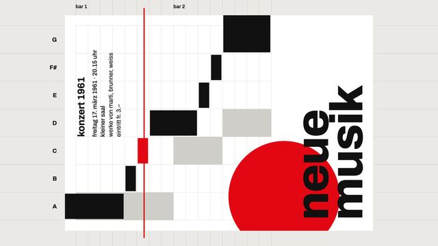</a> <b>Swiss Motion Graphics</b> <code>swiss-motion</code> · Identitas brand, Acara, Pendidikan desain</td>
<td width="33%" valign="top"><a href="styles/spy-titles/STYLE.md">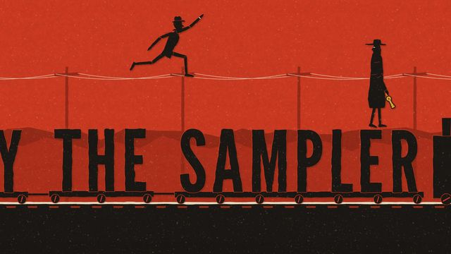</a> <b>60s Spy Title Sequence</b> <code>spy-titles</code> · Title sequence, Pembuka acara, Trailer</td>
<td width="33%" valign="top"> <b>Art Deco</b> <code>art-deco</code> · Mewah & perhotelan, Gala, Undangan</td>
</tr>
<tr>
<td width="33%" valign="top"><a href="styles/pictogram-motion/STYLE.md">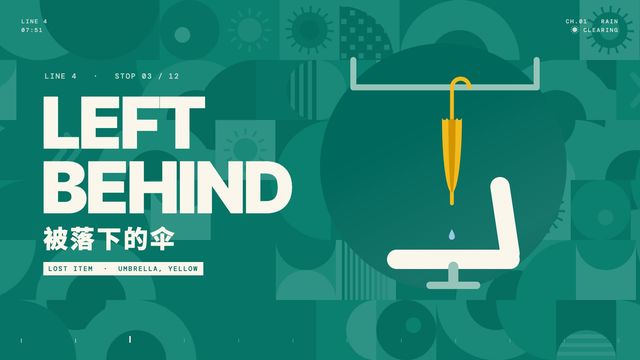</a> <b>Pictogram Motion</b> <code>pictogram-motion</code> · Layanan publik & kisah kota, Film identitas brand & acara, Explainer lewat tanda & benda</td>
<td width="33%" valign="top"><a href="styles/bauhaus-shapes/STYLE.md">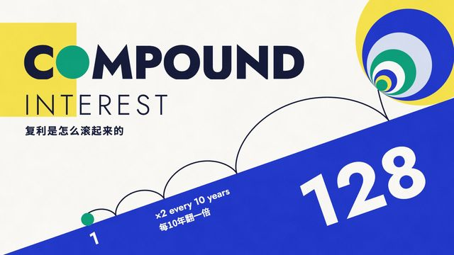</a> <b>Bauhaus Shapes</b> <code>bauhaus-shapes</code> · Penjelasan keuangan & ekonomi, Mekanisme & prinsip, Judul & kartu bab</td>
<td width="33%" valign="top"><a href="styles/flat-space-explainer/STYLE.md">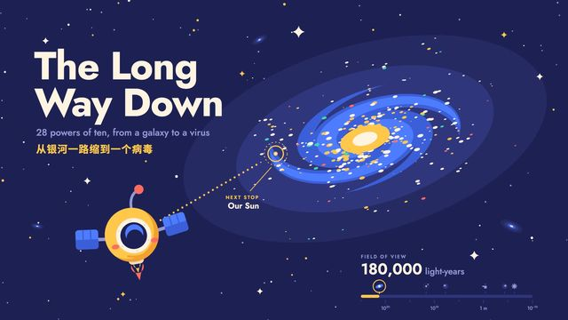</a> <b>Scale Zoom Explainer</b> <code>flat-space-explainer</code> · Penjelasan sains, Skala & ukuran, Kelas</td>
</tr>
<tr>
<td width="33%" valign="top"><a href="styles/text-flash-cuts/STYLE.md">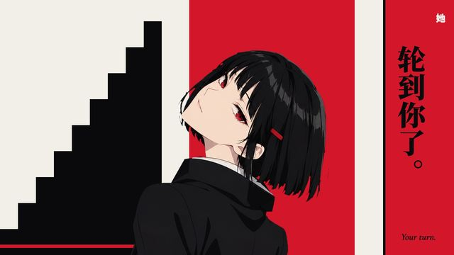</a> <b>Text Flash Cuts</b> ✦ <code>text-flash-cuts</code> · Trailer drama & ketegangan, Title sequence, Film manifesto</td>
<td width="33%" valign="top"><a href="styles/silhouette-rhythm/STYLE.md">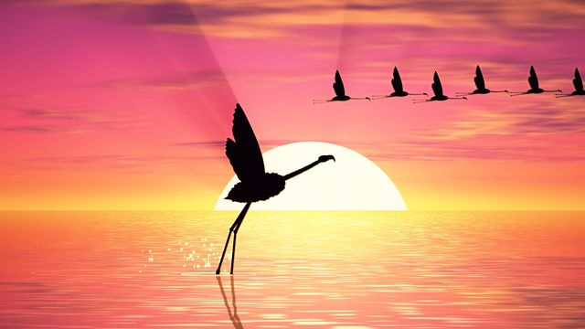</a> <b>Silhouette Rhythm</b> <code>silhouette-rhythm</code> · Video musik, Film olahraga & tim, Pembuka alam & festival</td>
</tr>
</table>

## Diagram Garis

Line Diagrams · 8 gaya

<table>
<tr>
<td width="33%" valign="top"><a href="styles/blueprint/STYLE.md">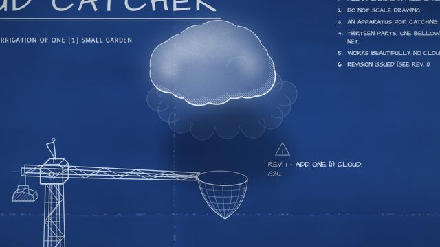</a> <b>Blueprint</b> <code>blueprint</code> · Teknik, Peluncuran perangkat keras, Penjelasan teknologi</td>
<td width="33%" valign="top"><a href="styles/iso-infographic/STYLE.md">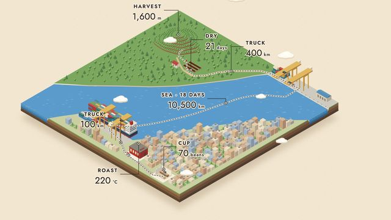</a> <b>Isometric Infographic</b> <code>iso-infographic</code> · Penjelasan proses, Rantai pasok, Laporan tahunan</td>
<td width="33%" valign="top"><a href="styles/teardown/STYLE.md">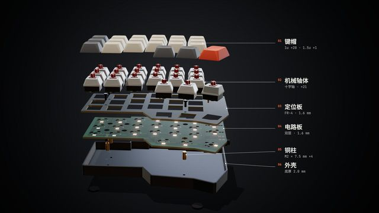</a> <b>Exploded Teardown</b> <code>teardown</code> · Peluncuran perangkat keras, Halaman produk, Penjelasan spesifikasi</td>
</tr>
<tr>
<td width="33%" valign="top"><a href="styles/hardcore-info/STYLE.md">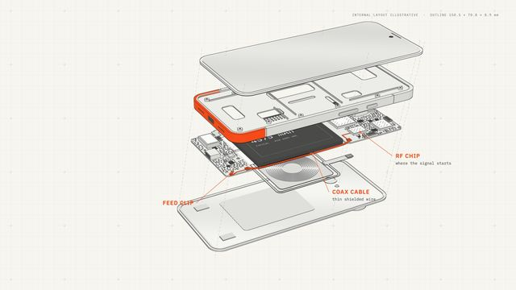</a> <b>Line-Art Cutaway</b> <code>hardcore-info</code> · Penjelasan perangkat keras, Rekayasa produk, Pendidikan sains</td>
<td width="33%" valign="top"><a href="styles/precise-mechanism/STYLE.md">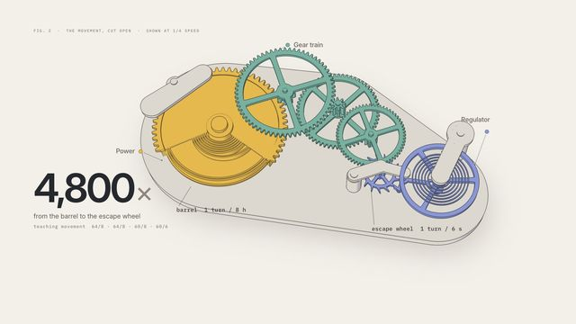</a> <b>Color-Coded Mechanism</b> <code>precise-mechanism</code> · Cara kerja mesin, Penjelasan produk & teknik, Pengajaran sains</td>
<td width="33%" valign="top"><a href="styles/instruction-manual/STYLE.md">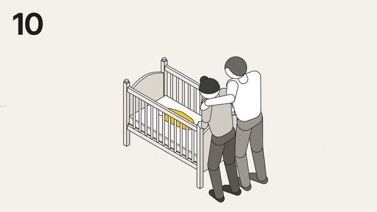</a> <b>Instruction Manual Art</b> <code>instruction-manual</code> · Panduan perakitan & setup, Instruksi keselamatan, Onboarding produk</td>
</tr>
<tr>
<td width="33%" valign="top"><a href="styles/pen-plotter/STYLE.md">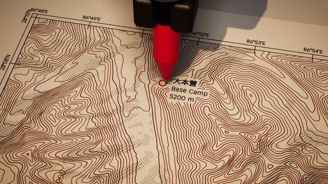</a> <b>Pen Plotter</b> <code>pen-plotter</code> · Peta & medan, Pengukuran & rekor, Gambar generatif & data</td>
<td width="33%" valign="top"><a href="styles/assembly-line-diagram/STYLE.md">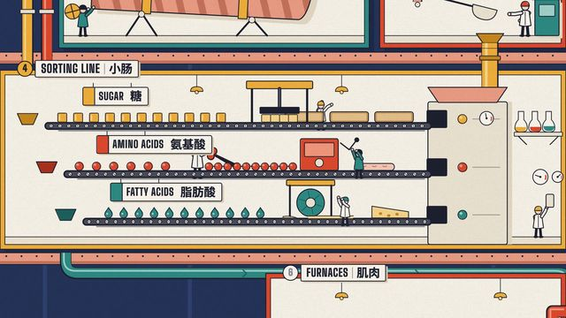</a> <b>Assembly-Line Diagram</b> <code>assembly-line-diagram</code> · Cara kerja proses, Biologi & kedokteran, Rantai pasok & alur proses</td>
</tr>
</table>

## Kartun

Cartoons · 6 gaya

<table>
<tr>
<td width="33%" valign="top"> <b>1930s Rubber Hose Cartoon</b> <code>rubber-hose</code> · Kuliner, Iklan retro, Anak-anak</td>
<td width="33%" valign="top"> <b>80s Cel Anime</b> <code>cel-anime-80s</code> · Video musik, Trailer game, Nostalgia</td>
<td width="33%" valign="top"> <b>Sci-Fi Sitcom Toon</b> <code>scifi-toon</code> · Komedi, Brand teknologi, Video pendek media sosial</td>
</tr>
<tr>
<td width="33%" valign="top"> <b>Mid-century Cartoon</b> <code>midcentury-toon</code> · Panduan setup, Pusat bantuan, Tutorial</td>
<td width="33%" valign="top"> <b>Comic History Cartoon</b> ✦ <code>comic-history</code> · Perubahan wilayah dalam sejarah, Penjelasan ringan geopolitik, Pangsa pasar & persaingan</td>
<td width="33%" valign="top"> <b>Manga Panels</b> ✦ <code>manga-panels</code> · Video musik, Peluncuran produk, Opening anime</td>
</tr>
</table>

## Game

Games · 4 gaya

<table>
<tr>
<td width="33%" valign="top"> <b>16-bit Pixel RPG</b> <code>pixel-rpg</code> · Trailer game, Rekap, Nostalgia</td>
<td width="33%" valign="top"> <b>2.5D Pixel Art</b> <code>hd-2d</code> · Trailer game, Fantasi, Film cerita</td>
<td width="33%" valign="top"> <b>Microgame Frenzy</b> <code>microgame</code> · Trailer game, Onboarding, Video pendek media sosial</td>
</tr>
<tr>
<td width="33%" valign="top"> <b>Rhythm Game Show</b> <code>game-show</code> · Linimasa teknologi, Kilas balik tahunan, Acara varietas</td>
</tr>
</table>

## Film & Pita

Film & Tape · 5 gaya

<table>
<tr>
<td width="33%" valign="top"> <b>CRT ASCII Terminal</b> <code>ascii-crt</code> · Alat developer, Fiksi ilmiah, Brand teknologi</td>
<td width="33%" valign="top"> <b>1920s Silent Film</b> <code>silent-film</code> · Komedi, Brand retro, Bercerita tanpa kata</td>
<td width="33%" valign="top"> <b>Liminal Found Footage</b> <code>backrooms</code> · Horor, Misteri & ARG, Teaser game</td>
</tr>
<tr>
<td width="33%" valign="top"> <b>Scratch Film</b> <code>scratch-film</code> · Hal yang terjadi dalam gelap, Dari satu tanda ke satu sistem, Petualangan kecil dalam cahaya & bayangan</td>
<td width="33%" valign="top"> <b>Double Exposure</b> <code>double-exposure</code> · Film brand & kota, Pembuka dokumenter & serial, Intro video musik</td>
</tr>
</table>

## Layar & Antarmuka

Screens & Interfaces · 6 gaya

<table>
<tr>
<td width="33%" valign="top"> <b>Dark Tech Keynote</b> <code>dark-keynote</code> · Peluncuran produk, SaaS, Keynote</td>
<td width="33%" valign="top"> <b>Mascot Screencast</b> <code>living-screencast</code> · Tutorial produk, Peluncuran fitur, Onboarding</td>
<td width="33%" valign="top"> <b>Sci-fi Hologram HUD</b> <code>hologram-hud</code> · Penelusuran spesifikasi, Video peluncuran, Pameran dagang</td>
</tr>
<tr>
<td width="33%" valign="top"> <b>Tabletop App Flythrough</b> <code>desktop-flythrough</code> · Penjelasan aplikasi, Alur kerja, Produk</td>
<td width="33%" valign="top"> <b>Spreadsheet Film</b> <code>spreadsheet</code> · Literasi data, Keuangan & biaya, Penjelasan analitik</td>
<td width="33%" valign="top"> <b>1-bit Dither</b> <code>one-bit-dither</code> · Sejarah lewat rangkaian media, Cetak, pindai & sinyal, Suasana malam & antariksa</td>
</tr>
</table>

## Cahaya & Garis

Light & Lines · 5 gaya

<table>
<tr>
<td width="33%" valign="top"> <b>Circuit Board</b> <code>circuit-board</code> · Energi, Rantai pasok, Perangkat</td>
<td width="33%" valign="top"> <b>Firefly Pointillism</b> <code>firefly-pointillism</code> · Cerita buku bergambar, Banyak menjadi satu, Lirik malam & alam</td>
<td width="33%" valign="top"> <b>Flow-field Wind Lines</b> <code>flow-field</code> · Badai, monsun & cuaca, Arus laut & banjir sungai, Aliran yang diukur terhadap ambang batas</td>
</tr>
<tr>
<td width="33%" valign="top"> <b>Oscilloscope Math</b> <code>oscilloscope-math</code> · Pelajaran matematika & fisika, Sinyal & elektronika, Penjelasan sains</td>
<td width="33%" valign="top"> <b>Neon Tubes</b> <code>neon-tubes</code> · Pembukaan toko & kisah maskot, Video musik city-pop & malam kota, Ident malam kota & festival</td>
</tr>
</table>

## 3D & Miniatur

3D & Miniature · 8 gaya

<table>
<tr>
<td width="33%" valign="top"> <b>Brick Toy</b> <code>brick-toy</code> · Mainan & anak, Perakitan produk, Antariksa</td>
<td width="33%" valign="top"> <b>Paper Pop-up Book</b> <code>paper-popup</code> · Buku anak, Trailer game, Film cerita</td>
<td width="33%" valign="top"> <b>Tilt-Shift Miniature</b> <code>tilt-shift</code> · Promosi kota, Properti, Transportasi</td>
</tr>
<tr>
<td width="33%" valign="top"> <b>Low-poly Isometric Island</b> <code>lowpoly-island</code> · Trailer game, Pembangunan dunia, Konten menenangkan</td>
<td width="33%" valign="top"> <b>Glass Product Render</b> <code>glass-product</code> · Peluncuran produk, Teknologi konsumen, Kecantikan</td>
<td width="33%" valign="top"> <b>Memphis Diorama</b> <code>memphis-diorama</code> · Hero website, Loop ambient, Musim</td>
</tr>
<tr>
<td width="33%" valign="top"> <b>Isometric People Scene</b> <code>isometric-picture-book</code> · Aturan sehari-hari, Antrean, Perbandingan</td>
<td width="33%" valign="top"> <b>Crayon World 3D</b> <code>crayon-world</code> · Cerita pendek, Penghormatan, Perjalanan</td>
</tr>
</table>

## Instrumen & Bukti

Instruments & Evidence · 8 gaya

<table>
<tr>
<td width="33%" valign="top"> <b>Satellite Briefing</b> <code>satellite-briefing</code> · Iklim, Penjelasan berita, Geografi</td>
<td width="33%" valign="top"> <b>Engineering Briefing Board</b> <code>briefing-board</code> · Teknik, Perbandingan pilihan, Briefing</td>
<td width="33%" valign="top"> <b>LiDAR Survey</b> <code>lidar-survey</code> · Warisan budaya, Lingkungan, Survei lokasi</td>
</tr>
<tr>
<td width="33%" valign="top"> <b>Under the Microscope</b> <code>microscope</code> · Biomedis, Ilmu material, Sains skincare</td>
<td width="33%" valign="top"> <b>Archive Light Table</b> <code>archive-lighttable</code> · Sejarah brand, Kisah arsip, Museum</td>
<td width="33%" valign="top"> <b>Security X-ray</b> <code>security-xray</code> · Pemeriksaan bandara & bea cukai, Pemeriksaan paket & kargo, Bagian dalam produk</td>
</tr>
<tr>
<td width="33%" valign="top"> <b>Radar Sweep Documentary</b> <code>dark-documentary</code> · Sejarah sains & teknik, Arkeologi, situs & rekonstruksi, Astronomi & luar angkasa</td>
<td width="33%" valign="top"> <b>Thermal Camera</b> <code>thermal-camera</code> · Inspeksi bangunan & energi, Satwa malam, Mesin & kelistrikan</td>
</tr>
</table>

## Data & Peta

Data & Maps · 6 gaya

<table>
<tr>
<td width="33%" valign="top"> <b>Data Storytelling</b> <code>dataviz</code> · Jurnalisme data, Laporan, Iklim & sains</td>
<td width="33%" valign="top"> <b>Projection-Mapped Model</b> <code>white-model</code> · Perencanaan kota, Pameran, Data kota</td>
<td width="33%" valign="top"> <b>Data Physicalization</b> <code>data-physical</code> · Laporan tahunan, Presentasi investor, Data energi</td>
</tr>
<tr>
<td width="33%" valign="top"> <b>Transit Map</b> <code>transit-map</code> · Transportasi, Pertumbuhan dari waktu ke waktu, Jaringan</td>
<td width="33%" valign="top"> <b>3D Map Explainer</b> <code>map-explainer</code> · Berita & geopolitik, Energi, perdagangan & pelayaran, Sungai, batas & medan</td>
<td width="33%" valign="top"> <b>Blob Simulation</b> <code>pip-simulation</code> · Evolusi & seleksi alam, Teori permainan & model agen, Epidemi, antrean & pasar</td>
</tr>
</table>

Still demo berlisensi CC BY 4.0; lihat [LICENSE](LICENSE). Pratinjau Mascot Screencast adalah style frame orisinal (maskot piksel dan aplikasi fiktif), karena gaya ini tidak disertai film demo.
