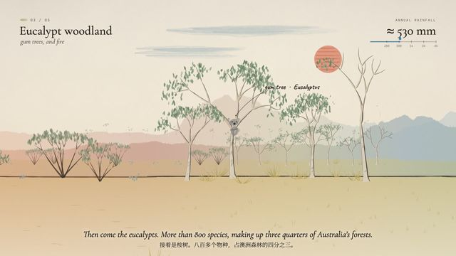
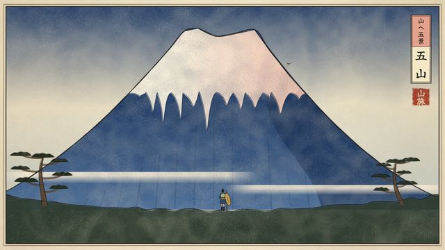
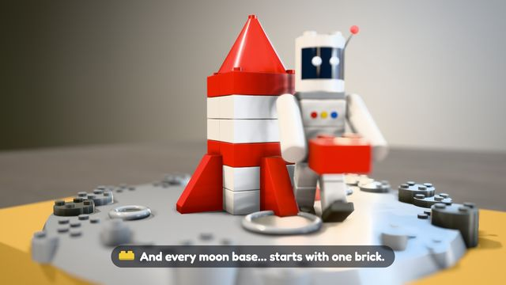
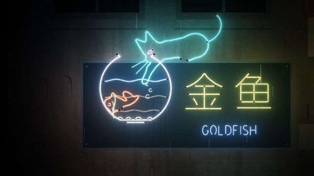
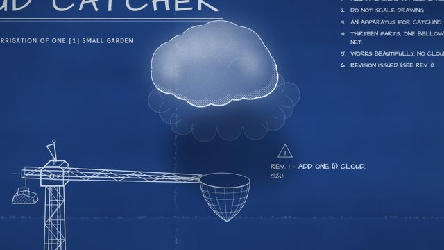
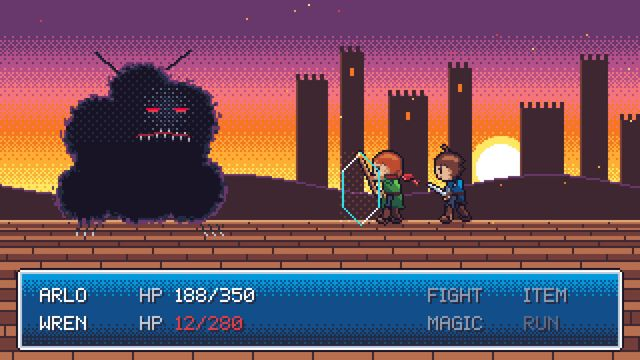

# Code Cinema by Megabagus

**99 gaya film untuk Claude. Pilih gaya, bawa cerita Anda, dan Claude membuat filmnya, sepenuhnya dengan kode.**

Tanpa video generation, tanpa stock footage. Setiap film disutradarai, digambar, diberi musik, dan di-mixing oleh Claude yang menulis kode: halaman canvas dan WebGL yang di-render frame demi frame, musik orisinal dari pustaka sampel gratis, dan narasi text-to-speech.

> [!IMPORTANT]
> **Dibuat untuk Claude.** Claude Opus dan Sonnet bisa dipakai; set effort ke **high** (di Claude Code, ketik `/effort high`). Model lain mungkin tidak mereproduksi gayanya dengan baik.

<table>
<tr>
<td width="33%"><a href="styles/watercolor/STYLE.md"></a><br><sub><b>Watercolor Brush</b></sub></td>
<td width="33%"><a href="styles/ukiyoe/STYLE.md"></a><br><sub><b>Ukiyo-e</b></sub></td>
<td width="33%"><a href="styles/brick-toy/STYLE.md"></a><br><sub><b>Brick Toy</b></sub></td>
</tr>
<tr>
<td width="33%"><a href="styles/neon-tubes/STYLE.md"></a><br><sub><b>Neon Tubes</b></sub></td>
<td width="33%"><a href="styles/blueprint/STYLE.md"></a><br><sub><b>Blueprint</b></sub></td>
<td width="33%"><a href="styles/pixel-rpg/STYLE.md"></a><br><sub><b>16-bit Pixel RPG</b></sub></td>
</tr>
</table>

**[▶ Lihat galeri lengkap 99 gaya](GALERI.md)**

## Cara kerjanya

1. **Pilih gaya.** Lihat [galeri 99 gaya](GALERI.md) untuk pratinjau visualnya, atau [daftar berbentuk tabel](styles/README.md), dikelompokkan dalam 15 kategori berdasarkan tampilannya, lengkap dengan contoh penggunaannya.
2. **Install skill-nya** (sekali saja, lihat di bawah).
3. **Minta ke Claude dalam satu kalimat:**

```text
Buat film 45 detik gaya Watercolor tentang kebun kopi keluarga saya. Narator perempuan, suara hangat.
```

Sebut gaya dengan nama Inggrisnya atau nama foldernya. Tambahkan durasi, narator, foto, atau musik milik Anda jika perlu:

> Buat film 40 detik gaya **Isometric Infographic** tentang alur distribusi produk UMKM dari petani ke konsumen.

> Buat explainer 60 detik gaya **Whiteboard Explainer** tentang apa itu Machine Learning, untuk peserta pelatihan pemula.

Belum yakin mau apa? Ketik `/code-cinema-by-megabagus:code-cinema-by-megabagus` saja. Claude akan menanyakan bahasa, lalu menawarkan pilihan: film dengan gaya library, mengubah gaya menjadi milik Anda, atau membuat gaya dari nol.

## Install

**Sebagai skill (disarankan).** Di terminal:

```sh
claude plugin marketplace add pendekarAI/code-cinema
claude plugin install code-cinema-by-megabagus@megabagus
```

Setelah itu bisa dipakai dari folder mana pun. Pada pemakaian pertama, skill mengunduh panduan, alat, dan prompt gaya ke `~/code-cinema`, dipakai bersama oleh semua film Anda; setiap proyek film disimpan di folder tempat Anda memulai.

**Atau clone repo ini.** Film disimpan di `films/<nama>/` di dalamnya.

```sh
git clone https://github.com/pendekarAI/code-cinema.git
cd code-cinema
claude
```

### Update atau uninstall

Update, lalu restart Claude Code (library di `~/code-cinema` memperbarui dirinya sendiri di film berikutnya):

```sh
claude plugin marketplace update megabagus && claude plugin update code-cinema-by-megabagus@megabagus
```

Dari clone: `git pull`, lalu jalankan sekali `sh plugin/skills/code-cinema-by-megabagus/scripts/setup.sh deps` (hanya memperbarui paket inti yang berubah; jika Anda memasang paket voice atau music, jalankan `… deps voice music`).

Uninstall, lalu hapus `~/code-cinema`:

```sh
claude plugin uninstall code-cinema-by-megabagus@megabagus
```

Gaya milik Anda di `~/code-cinema-styles/` tetap aman saat update dan uninstall; hapus folder itu sendiri jika tidak diperlukan lagi.

## Yang terjadi setelah Anda meminta film

Claude bertanya sekali di awal: hal tentang topik yang tidak bisa ia putuskan sendiri; apakah Anda punya **suara, musik, atau materi lain**; dan apakah Anda ingin melihat **storyboard** dulu (jika ya, ia berhenti sekali untuk menunjukkan shot kunci dalam gaya aslinya; jika tidak, ia langsung membuat film jadi).

Lalu Claude membaca tiga panduan dan bekerja seperti studio kecil:

| File | Isinya untuk Claude |
|---|---|
| [`DIRECTOR.md`](DIRECTOR.md) | cara menyutradarai: cerita, suara, ritme, kamera, akting, pemeriksaan |
| [`TECHNIQUE.md`](TECHNIQUE.md) | cara membangun: rendering frame demi frame, suara, musik, mixing |
| `styles/<gaya>/STYLE.md` | seperti apa tampilan dan suara gaya itu; ceritanya milik Anda |

Hasilnya diserahkan di folder proyek: file `.mp4`, poster, subtitle `.srt`, treatment, daftar kredit aset, dan source lengkap dengan `build.sh` satu perintah.

### Sebelum mulai

- Satu film butuh sekitar 30–60 menit kerja Claude dan cukup banyak token.
- Anda butuh **Node 20+**, **ffmpeg 7+**, dan **Python 3.11+** (atau [uv](https://docs.astral.sh/uv/)); Claude memasang sisanya. Ubuntu 24.04 membawa ffmpeg 6.1 yang terlalu lama: pakai static build.
- Tiga gaya (Manga Panels, Text Flash Cuts, Comic History Cartoon; bertanda ✦ di [daftar gaya](styles/README.md)) menggambar karakternya dengan generator gambar yang Anda sediakan. Tanpa itu, ketiga gaya ini tidak bisa dimulai; gaya lain bisa jalan tanpanya.
- Output default 1920×1080 pada 24 fps (beberapa gaya memakai frame rate sendiri); ukuran lain, misalnya vertikal 1080×1920 untuk Reels, bisa diminta.
- Untuk narasi bahasa Indonesia, Claude memakai suara neural Microsoft (`id-ID-GadisNeural` atau `id-ID-ArdiNeural`) yang butuh koneksi internet.

## Jadikan gaya milik Anda

Warna brand, logo, karakter, atau nuansa channel Anda: ubah gaya library menjadi gaya yang hanya milik Anda, atau buat gaya dari halaman kosong.

> Saya mau mengubah gaya **Ukiyo-e** menjadi versi saya sendiri.

> Mulai dari nol: gaya kapur di papan tulis, hangat dan pelan.

Claude akan:

1. **Merencanakannya bersama Anda, satu pertanyaan per pesan**: untuk apa (jenis film, platform, warna brand, logo, font), apa yang diubah, dan namanya. Setiap pertanyaan punya rekomendasi beserta alasannya. Jawaban samar seperti "lebih premium" atau "lebih ceria" diterjemahkan menjadi perubahan konkret untuk dipilih.
2. **Menunjukkan ringkasan**: setiap bagian sebelum, sesudah, dan konsekuensinya. Tidak ada yang ditulis sebelum Anda setuju.
3. **Menunjukkan satu style frame dulu**, digambar dengan kode yang sebenarnya; jika mengubah gaya library, gaya aslinya ikut di-render di sebelahnya.
4. **Membuat film demo 15–30 detik** yang menampilkan setiap perubahan.
5. **Menyimpannya jika Anda puas** di `~/code-cinema-styles/<nama>/`. Setelah itu cukup sebut namanya: *"Buat film 30 detik gaya **Batik Senja** saya tentang…"*

Langkah lengkap yang diikuti Claude ada di [`MY-STYLES.md`](MY-STYLES.md).

## Daftar gaya

99 gaya dalam 15 kategori: Edit & Dokumenter · Lukisan & Ilustrasi · Sketsa & Papan · Kerajinan Tradisional · Cetak & Seni Grafis · Grafis & Tipografi · Diagram Garis · Kartun · Game · Film & Pita · Layar & Antarmuka · Cahaya & Garis · 3D & Miniatur · Instrumen & Bukti · Data & Peta.

Pratinjau visual setiap gaya: **[GALERI.md](GALERI.md)**. Daftar berbentuk tabel, contoh penggunaan, dan folder setiap gaya: **[styles/README.md](styles/README.md)**.

## Untuk siapa

- **Trainer dan pengajar**: video explainer untuk materi kelas, pembuka sesi, ringkasan modul.
- **Pelaku usaha dan UMKM**: video promosi produk, profil usaha, peluncuran.
- **Konten kreator**: Reels, Shorts, dan konten edukasi dengan gaya visual yang berbeda dari kebanyakan.
- **Analis dan konsultan**: data storytelling, laporan visual, presentasi hasil riset.

---

Dikembangkan oleh **Mega Bagus Herlambang** · [megabagus.id](https://megabagus.id) · [github.com/pendekarAI](https://github.com/pendekarAI)

<sub>**Credits & lisensi.** Code Cinema adalah versi berbahasa Indonesia dari *Lemo-Opuscar* karya Lemomo (LemoLab). Kode: MIT. Panduan dan prompt gaya: CC BY-NC 4.0. Still dan subtitle demo: CC BY 4.0. Film yang Anda buat sepenuhnya milik Anda. Detail di [LICENSE](LICENSE).</sub>
